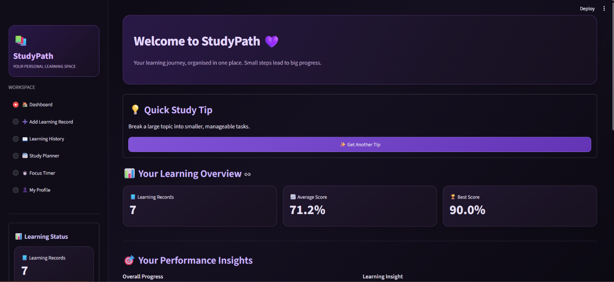
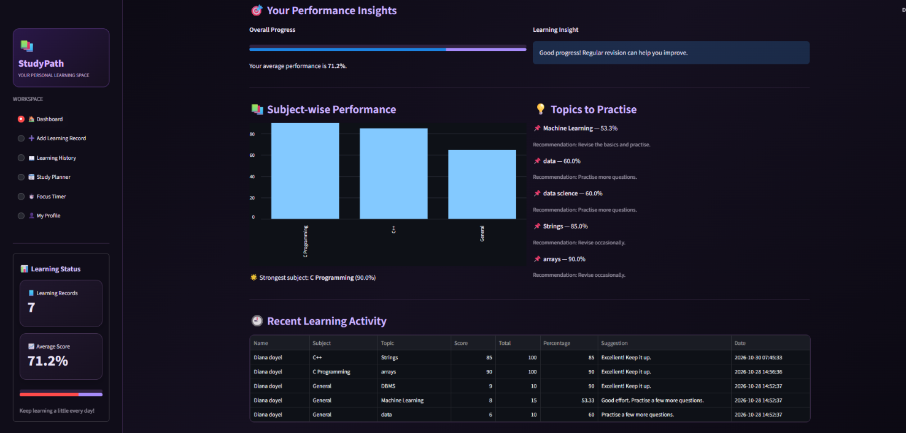
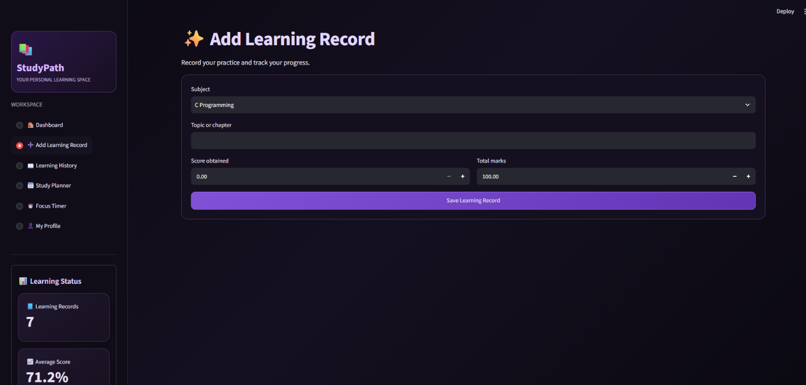
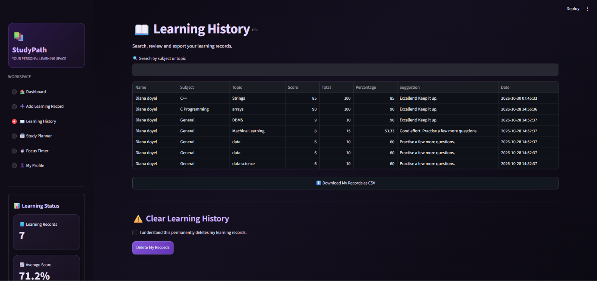
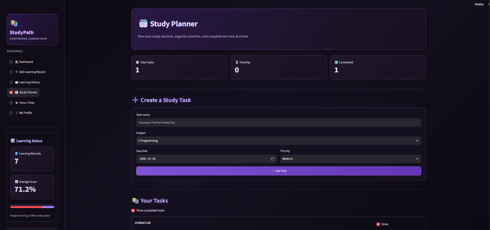
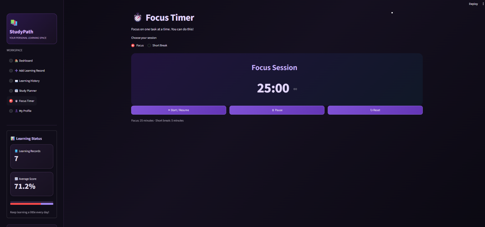
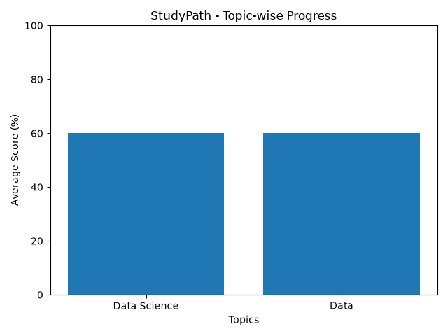

# 📚 StudyPath – Student Learning & Progress Assistant

StudyPath is a student-focused learning and progress tracking application built using Python. It helps students record their learning activities, monitor academic progress, analyse performance, and organise their study routine.

The project initially started as a command-line application and was later developed into a web application using Streamlit, SQLite, and Pandas.

## ✨ Features

### 🌐 Streamlit Web Application

- **User Authentication** – Sign up, log in, and securely manage accounts.
- **Dashboard** – View learning statistics and performance summaries.
- **Learning Records** – Add and manage learning activities and quiz scores.
- **Learning History** – Search, view, and export previous learning records.
- **Smart Recommendations** – Get suggestions based on learning performance.
- **Study Planner** – Create, update, and manage study tasks.
- **Focus Timer** – Organise focused study sessions.
- **My Profile** – Update personal learning profile details.
- **Data Persistence** – Store user profiles and learning records using SQLite.

### 💻 Command-Line Application

The original CLI version includes:

- Record new learning activities.
- View learning history.
- Display performance dashboards.
- Analyse topic-wise progress.
- Generate smart learning recommendations.

## 📸 Application Screenshots

### Dashboard





### Add Learning Record



### Learning History



### Study Planner



### Focus Timer



## 📊 Progress Visualization

The project includes a Matplotlib-based chart generator that displays average performance across topics.



*Example visualization using sample testing data.*

## 🛠️ Technologies Used

- Python
- Streamlit
- Pandas
- SQLite
- Matplotlib
- HTML & CSS

## 📁 Project Structure

```text
StudyPath/
│
├── screenshots/
│   ├── dashboard1.png
│   ├── dashboard2.png
│   ├── add-record.png
│   ├── learning-history.png
│   ├── study-planner.png
│   └── focus_timer.png
│
├── app.py
├── main.py
├── progress_chart.py
├── study_progress.png
├── requirements.txt
├── README.md
└── .gitignore
```

Local files excluded from GitHub:

- `progress.csv`
- `studypath.db`
- `.venv/`

## 🚀 Getting Started

### 1. Clone the Repository

```bash
git clone https://github.com/TitishaDoyel/StudyPath.git
```

### 2. Navigate to the Project Folder

```bash
cd StudyPath
```

### 3. Create a Virtual Environment

```bash
py -3.12 -m venv .venv
```

### 4. Activate the Environment

**Windows PowerShell:**

```powershell
.\.venv\Scripts\Activate.ps1
```

### 5. Install Dependencies

```bash
python -m pip install -r requirements.txt
```

### 6. Run the Streamlit Application

```bash
python -m streamlit run app.py
```

### 7. Run the CLI Application

```bash
python main.py
```

### 8. Generate the Progress Chart

```bash
python progress_chart.py
```

## 🔐 Data & Privacy

- SQLite is used to store account details, profiles, learning records, and study tasks.
- Passwords are stored as PBKDF2 password hashes.
- Personal database files and local learning data are excluded from the public repository.
- The project uses `.gitignore` to prevent private files and virtual environments from being uploaded.

## 🎯 Project Objective

The main objective of StudyPath is to help students build consistent learning habits, understand their academic progress, identify topics that need more practice, and manage their study activities in one place.

## 🔮 Future Improvements

- AI-powered personalised learning recommendations.
- Weekly and monthly progress reports.
- More detailed performance visualisations.
- Study goal tracking and reminders.
- Improved learning analytics.

---

**Built with Python as a personal learning and portfolio project.**
